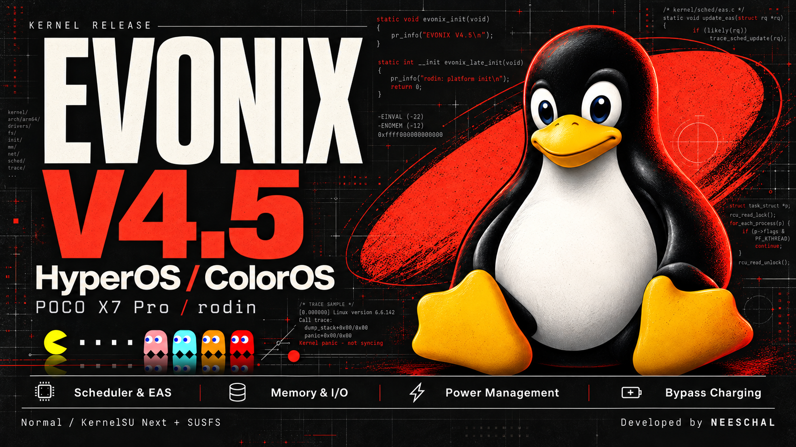

# EVONIX Kernel

EVONIX is an Android 15 / Linux 6.6.142 kernel for Poco X7 Pro (`rodin`).
V4.5 provides separate HyperOS and ColorOS builds, with either
KernelSU Next + SUSFS or no built-in root.

## V4.5

- Latency-sensitive scheduling, PREEMPT_SHORT and EAS placement improvements.
- Reduced CPUFreq accounting, CPU-selection and load-balancing overhead.
- Memory reclaim, suspend, swap readahead and filesystem fixes.
- Reduced redundant power-management and deferred-buffer worker activity.
- Native OPlus SchedAssist, FrameBoost and memory integration for ColorOS.
- Shared OEM bypass-charging support for HyperOS and ColorOS.
- KernelSU Next v3.4.1 with SUSFS v2.3.0 in KSU variants.

See [CHANGELOG.md](CHANGELOG.md) for the full changelog.

[Download V4.5](https://github.com/NEESCHAL-3/EVONIX-Kernel/releases/tag/v4.5)
and follow the [installation guide](Documentation/evonix/INSTALLATION.md).

## Choose your build

| ROM family | Built-in root | Branch |
| --- | --- | --- |
| HyperOS | KernelSU Next + SUSFS | `hyperos/ksu-susfs` |
| HyperOS | None | `hyperos/normal` |
| ColorOS port | KernelSU Next + SUSFS | `coloros/ksu-susfs` |
| ColorOS port | None | `coloros/normal` |

The default branch is `hyperos/ksu-susfs`. The permissive branch is excluded
from V4.5 and was not updated.

## Build and integration

This repository is the `common/` project in an Android Kleaf workspace,
not a standalone build environment. Follow
[BUILDING.md](Documentation/evonix/BUILDING.md), including the pinned
Clang 23 toolchain, ThinLTO and AutoFDO profile.

Release ZIPs replace the kernel Image through AnyKernel; they do not replace
vendor_boot, recovery or vendor modules. OEM bypass operation, supported
interfaces and measurement limits are documented in
[BYPASS_CHARGING.md](Documentation/evonix/BYPASS_CHARGING.md).
Charging policy restoration is a userspace responsibility.

## Security

The four release branches enforce SELinux. Inherited vendor-module
version-check relaxation remains a security and compatibility limitation;
see [SECURITY.md](SECURITY.md). Baseband-guard does not eliminate all
possible privileged partition-write paths.

A successful compile is not a guarantee of ROM compatibility, better FPS,
lower temperature or lower battery consumption. Keep a known-good boot image
and a recovery path before flashing.

See [architecture](Documentation/evonix/ARCHITECTURE.md),
[branches](Documentation/evonix/BRANCHES.md) and [CONTRIBUTING.md](CONTRIBUTING.md).
The kernel is GPL-2.0 licensed; see [COPYING](COPYING).
